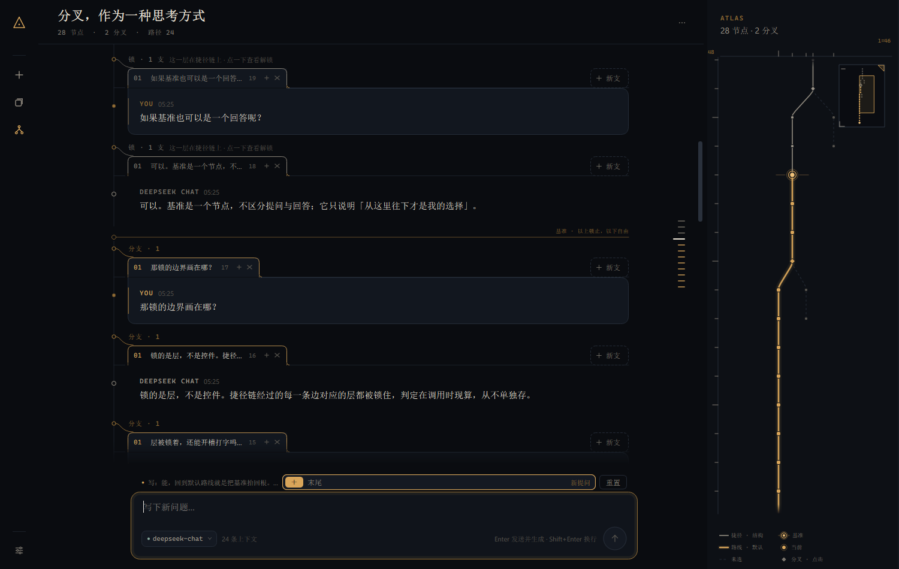
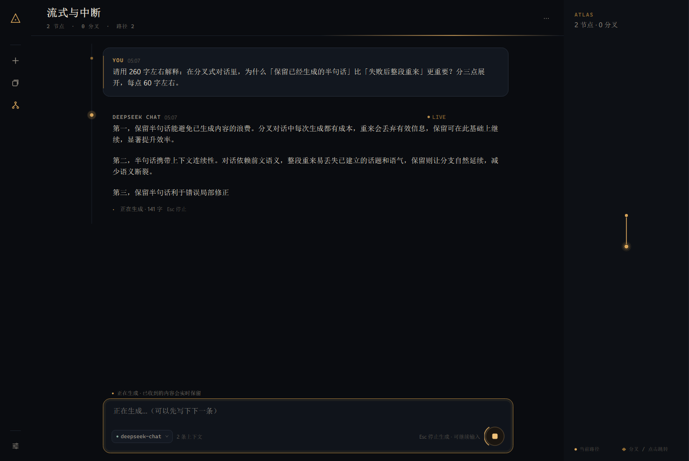
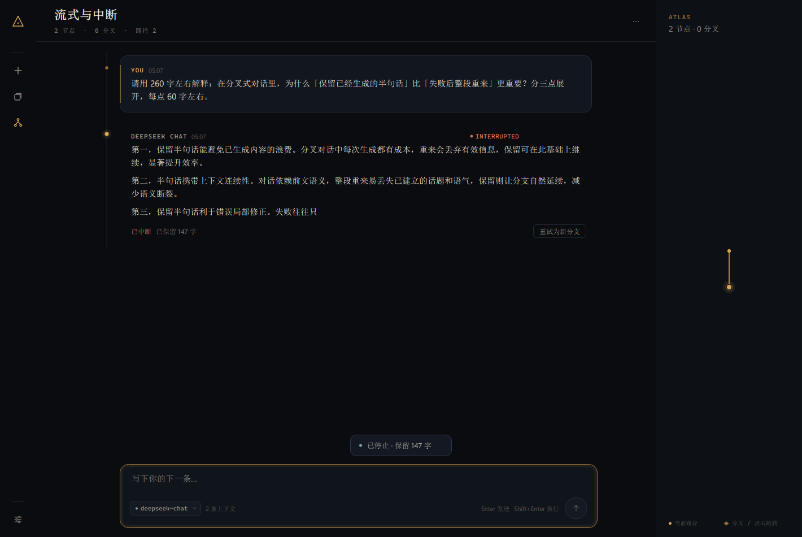
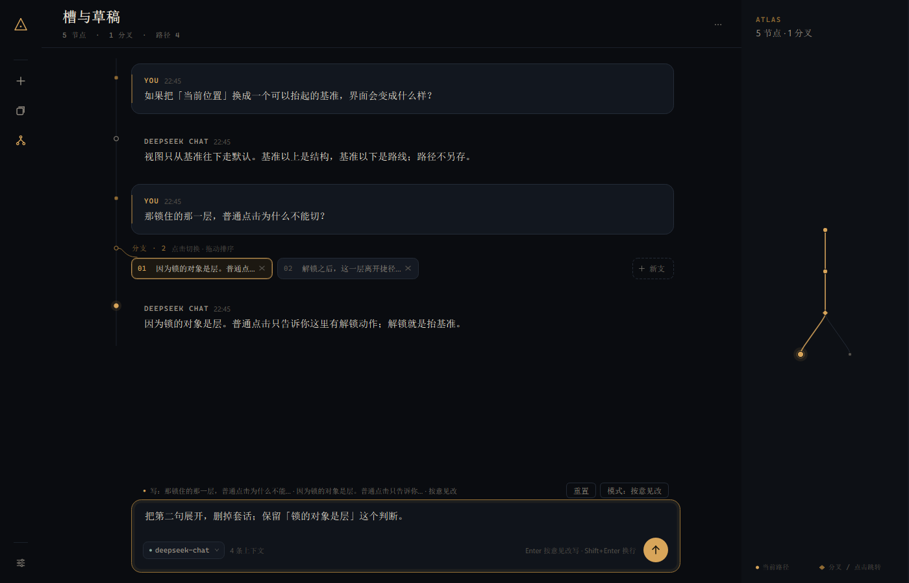
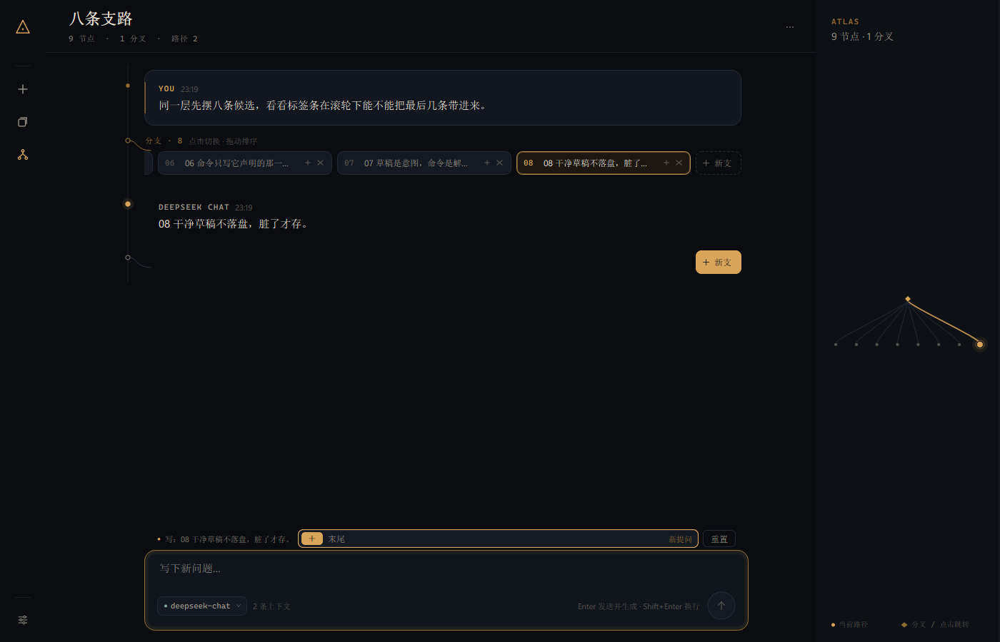
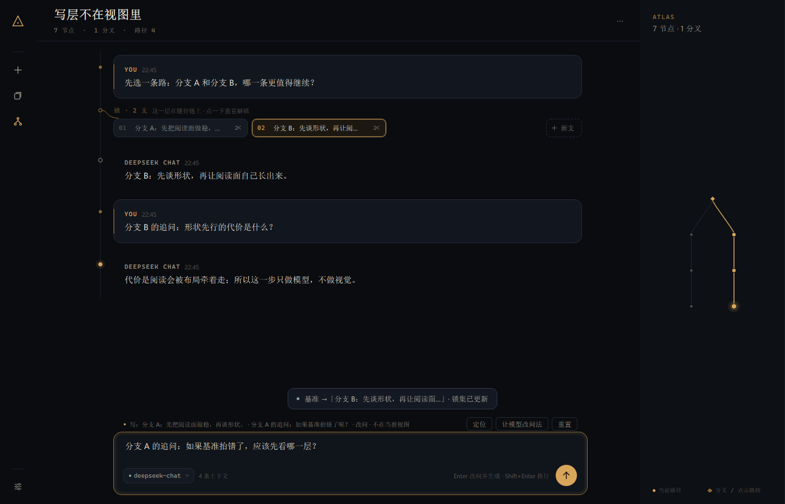

# Delta

**一条链，一个基准，一组还没发出的意图。**

一个人对着模型工作。没有联系人、没有消息投递、没有已读回执。只有一条视图、视图起点那个可以抬起来的基准，和每个位置上还没发出的意图。



## 30 秒启动

需要 Python 3.11+、PySide6、Markdown。密钥放在 User 环境变量 `DEEPSEEK_API_KEY` 里。

```powershell
cd D:\LMY\coding\aichat\a
.\run.ps1
```

`run.ps1` 会自动从 User 环境变量取出密钥、找到本机解释器并启动。用别的解释器：

```powershell
$env:DELTA_PYTHON = "C:\path\to\python.exe"
.\run.ps1
```

或者：

```powershell
pip install -r requirements.txt
$env:DEEPSEEK_API_KEY = [Environment]::GetEnvironmentVariable("DEEPSEEK_API_KEY","User")
python -m delta
```

默认数据目录是 `%APPDATA%\Delta`；加 `--data D:\somewhere` 可换。

## 怎么用

- **视图**只有一条：根 → 从基准沿默认走到的叶子。基准以上走**结构**，基准以下走**默认**；没有另存的"当前位置"。
- **层**是 parent 底下那排孩子。层上有两类**槽**：
  - 末尾的 **+**：这一层的"再来一个"（提问层 → 新提问；回答层 → 再生成）；
  - 每颗备选自己的槽：提问备选 → 改问；回答备选 → 按意见改 / 自己改。
- 点开一个槽 = 输入框归它。上方是**目标标记**（写层 + 编号/底稿 + 模式），和目标标签同编号、同描边；打字只改这份草稿；切走再回来还在。同一层可以同时有多份草稿，互不覆盖。
- 草稿有模式、初始文本和 dirty：
  - **重置**回到当前模式的初始文本（初始为空、底稿原文、回答原文）；脏了才可点；
  - 回答备选的两种模式可切换；写过会确认，确认后可撤销一次；
  - 提问槽里的 **让模型改问法** 只替换草稿，不落节点。
- **发送 = 执行当前槽的命令**，不一定是视图末端：
  - 新提问 / 改问 = 提问 + 回答的复合命令；
  - 再生成 / 按意见改 / 自己改 = 只写回答层；
  - 按意见改为空 = 普通再生成；改问/自己改与底稿完全相同会被禁用。
- **写层被锁**时仍可开槽、打字；发送会进入两步确认（只抬基准），草稿全程保留，抬完再按一次发送。
- **写层不在当前视图**时目标标记变红，行里写明"不在当前视图"，并给一个显式的 **定位**（set_baseline，不自动跳）。
- **标签行滚轮**：鼠标在标签行上滚轮、Shift+滚轮都横向滚动；滚到两端也不穿透到正文。
- **标签行**：每一层是同一条 72px 行（标题 + 标签 + 末尾「新支」）。视图穿过的那一支**和下面的消息连在一起**——标签下沿不封口，两侧翻出小脚落在消息的上边上，消息自己的顶边在标签处断开；其余标签是闭合的小签，站在同一条线上。
- **每颗标签有 +**： 一直在（点开才是它的打开态），点开以后  变成一个小槽、编号变成铜牌，输入框归这支。末尾小签也有打开态。
- **拖动标签**：6px 起拖，标签抬起跟手（像素图，带影），原位留一个等宽空位；其余标签 150ms 让位；滚轮和贴近边缘的自动滚动都会重算落点；松手只写一次 reorder，Esc 弹回。锁住的层不响应拖动。
- **干净草稿不落盘**：没输入过、或重置后的 clean 草稿不写 `ui.slots`，缺省读取就是当前模式的初始文本；流式时 clean 草稿仍继续跟随初始文本。
- **锁**：某一层在捷径链（根 → 基准）上时，切换、新建、关闭、重排全部不可用。点一下只会进入确认态；确认 = **把基准抬到这一层的 parent**，四类操作一起恢复。不设单键快捷键。
- **锁区长得也不一样**：捷径链上的层，标签/标题/肘线转灰；消息里的 `YOU` 和左侧条降到暗金（你的话还在，只是退后）；层的默认孩子若不在视图里，标签顶上给一道暗金 cap。基准下面一条**锁定水位线**：「以上锁止，以下自由」。亮金因此只出现在水位线以下——和 ATLAS 的灰线是同一句话。
- **ATLAS** 点节点 = **设基准**；锁集是派生出来的，从不单独写。图上一套三层语言：实线是默认孩子、虚线是没选的那几支；灰线是 root → 基准 的结构，金线是基准以下的路线；基准是双环加两侧短线。悬停先告诉你这一支是什么，再让你点。每次基准变化都会给一条文字提示。**边缘可以拖宽**（最小 236px），多出来的宽度用于拉开分叉；宽度记在设置里。**两个维度各自「适应 / 固定」**：适应是现算（节点增减、切分支、拖宽都会重算），固定存一个「每单位的 px」。左尺是竖直（一层 = 1 单位）、上尺是水平（一个叶子槽 = 1 单位）：拖哪把尺，哪个维度就从适应转成固定（从当前值起步，不跳变），双击它回到适应；`Ctrl+滚轮` ×1.1 只乘固定的维度。溢出时单轴溢出滚轮给那轴、双轴溢出滚轮只竖向，按住画布可以两向拖；右上角缩略图带视界框，能拖能改大小。细节见 [docs/DESIGN.md](docs/DESIGN.md)。
- **右缘的回合发丝条**：一条短丝 = 一轮「你 + 助手」。**水位线以上走灰、以下是金**——和标签条、ATLAS 说的是同一句话；当前那轮最长最亮（20px），指针下那条在自己的色族里提亮，并叫出预览卡（轮次编号 + 提问首句 + 回答开头，最多三行）。点一条**只滚到那一轮，不动基准**。间距固定 10px、不按比例压缩——条数多了就在框内自己滚，两端渐隐。少于两轮不画。
- 顶栏菜单：**回到默认路线**（基准 = 根）和 **把捷径写进默认…**（只写链上各层的默认，不解锁、不改基准）。
- 单孩子层也是同一条行，不省标题；右键菜单仍是快捷方式。
- **Enter** 执行，**Shift+Enter** 换行，**Esc** 停止（已收到的半个回答保留）；**Ctrl+N** 新对话，**Ctrl+L** 对话库，**Ctrl+M** 收起/展开 ATLAS。

## 它特别在哪

不是把树画成一张需要拖拽的画布，也不是在聊天气泡旁边塞一棵缩进树。

**模型只有三样状态**：结构（孩子 + 出生序 + 每层展示序）、每层至多一个活动孩子、基准。视图、捷径链、锁层、路线段全是**派生**的。没有路径副本，没有"当前节点"字段。

**锁的对象是层，不是控件。** 标签条、右键菜单、快捷键都只是入口；所有会改层的入口只经过命令层，每条基本命令声明自己的写层，执行器先 `require_open(write_layer)`，再在同一个写作用域里调用层写入。命令层之外的代码直接调层写入会被作用域测试挡住。唯一的全局例外是"把捷径写进默认"，它需要显式确认，并且只写链上各层的默认。

**槽是意图，命令是解释。** 槽只存"模式 + 文本 + dirty"；发送那一刻才从槽推导出写层、读集、效果和逆操作。草稿动作（重置、换模式、让模型改问法）不写层，所以不受锁影响。发送新提问是两条基本命令（提问层 + 新回答层），各自过门。

**切换只换后缀**：视图的前缀控件原样保留，切回来复用同一张卡片；流式只改一个卡片；重启只恢复基准、活跃槽和滚动锚点。

## 数据与性能

- **结构**：节点 + parent；出生序 append-only；每层展示序是独立排列。
- **默认**：字段挂在 parent 上，语义是"这一层的活动孩子"，至多一个，可空。
- **基准**：一个节点；空对话为 `None`。
- **视图**：`祖先链(descend(基准))` — 纯函数。
- **命令**：基本命令声明写层、读集、效果、逆操作；`commands.execute` 对每一步先过门、再开写作用域；复合命令逐层。
- **持久化**：每次操作原子写 JSON（schema 2）；旧文件（schema 1）在内存里迁移：把旧可见链一次性写进默认、基准 = 根，首屏不变、无锁、回默认不跳。
- **槽与草稿**：存 `ui.slots` 子文档（版本化）：活跃槽 + 每个槽的模式/文本/dirty；旧 `ui.draft` 按视图叶映射到对应槽，不丢字；节点或层被删时相关槽/草稿被清掉；clean 草稿不写，缺省即当前模式的初始文本。
- **流式**：后台 daemon 线程只把 delta 放进队列；主线程 14ms 批量取一次。流式期先追加纯文本草稿，完成时一次性做完整 markdown 排版。




**一个槽开着**（02 标签打开；输入框上方的 02 目标标记指向它，层名/编号/底稿/模式同屏）：



**八条标签，滚轮滚到末尾**（最后几条进入视野；标签行自己消费滚轮，不穿透正文）：



**写层不在当前视图**（目标标记变红 + "不在当前视图" + 定位；视图在分支 B，活跃槽在分支 A）：



## 测试

```powershell
python -m pytest -q
```

130 个测试：层与基准的派生（视图纯函数、锁集、默认/展示序/出生序）、命令写作用域（直接调层写入与越层命令都被挡住、逆操作声明）、四个改层门禁、关闭相邻接替、固化、核心防御性删除、schema 1 迁移、槽/草稿/模式切换/重置/逆操作、旧 `ui.draft` 映射、活跃槽持久化、原子存储、SSE 错误分类/中断保留、UI 的前缀控件身份与缓存复用、单行标签条溢出滚动、锁定层两步确认、发送锁层保留草稿、ATLAS 的边角色（捷径 / 路线 / 未选）、默认边一层至多一条、ATLAS 点击只改基准、标签拖动的真实手势（reorder / Esc 回弹）、每层都有标题行、右键入口、无 UI 旁路静态扫描、重启一致性、快速乱点。结果见 [docs/TEST_RESULTS.md](docs/TEST_RESULTS.md)。

这一轮新增：标签行滚轮/Shift+滚轮横向滚动且两端不穿透、每颗标签的 + 与打开态、单孩子层可见标签、输入目标标记的编号/标题/变色/定位、干净草稿不落盘。

性能见 [docs/BENCH.md](docs/BENCH.md)：typing p95 7.29ms；render p95 9.92ms；layer switch p95 31.54ms（单孩子标签行可见后，切换重建的行更多）。

## 结构

```
delta/core/     零 Qt：model（层/基准/写作用域）、commands、slots、context、store、SSE client
delta/ui/       PySide6：transcript、layer bar、message、composer、atlas、...
tests/          pytest：核心 + UI
spikes/         被否决的 V1
tools/          demo、基准、真实模型探针
```

## 已知边界

- 这一轮做标签条的形态与语言：贴合/开口、锁区灰 + 水位线、槽形 +、像素图拖动；**滚动条还是系统样式**，没做视觉处理。
- 每一层都有同一条 72px 的标签行（标题 + 一行标签），单孩子层也不例外；垂直空间因此比"连体单孩子标签"多一行。
- 截图（streaming / slot_open / tab_wheel / slot_offview）还是旧标签条的形态，做滚动条时一起重拍。
- Markdown 是 Qt 富文本的子集；流式期间是纯文本草稿，完成时才排版。
- ATLAS 为小树设计；几百个节点会变密，尚无搜索/缩放。
- 密钥从环境变量读取；删除单条消息没有撤销（整份对话删除会进 trash）。
- 单人、单机、单 provider（OpenAI 兼容；默认 DeepSeek）。

## 一句话

**最值得说的是：视图不是被存下来的，而是被算出来的——结构、每层至多一个活动孩子、一个基准。发送也不是往树里塞消息，而是执行当前槽声明的一条命令；锁不是开关，而是基准派生出来的一组层。槽是意图，命令是解释，层才是对象。**
