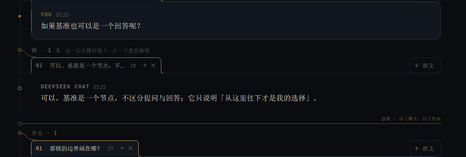
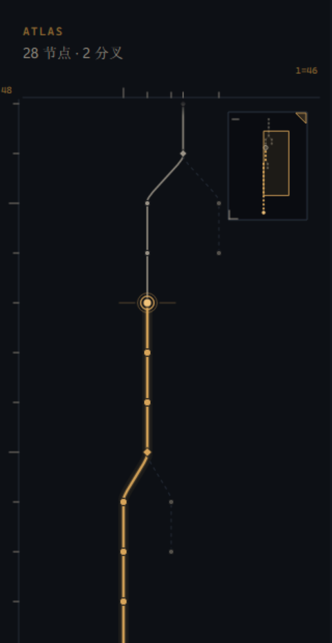
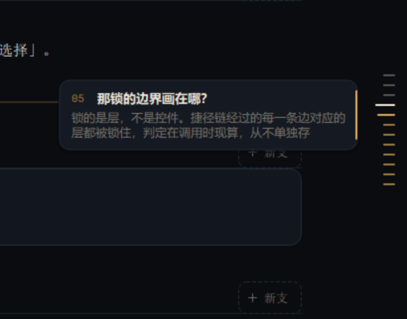

# Delta

**一条链，一个基准，一组还没发出的意图。**

一个人的对话客户端。没有联系人、没有消息投递、没有已读回执。只有一条视图、视图起点那个可以抬起来的基准，和每个位置上还没发出的意图。


## 30 秒启动

需要 Python 3.11+、PySide6、Markdown。密钥放在 User 环境变量 `DEEPSEEK_API_KEY` 里。

```powershell
cd D:\LMY\coding\aichat\a
.\run.ps1
```

`run.ps1` 会从 User 环境变量取出密钥、找到本机解释器并启动。用别的解释器：

```powershell
$env:DELTA_PYTHON = "C:\path\to\python.exe"
.\run.ps1
```

也可以手工：

```powershell
pip install -r requirements.txt
$env:DEEPSEEK_API_KEY = [Environment]::GetEnvironmentVariable("DEEPSEEK_API_KEY","User")
python -m delta
```

数据目录默认 `%APPDATA%\Delta`，加 `--data D:\somewhere` 可换。

## 模型只有三样

- **结构**：节点 + parent。出生序 append-only；每层展示序是独立排列。
- **默认**：字段挂在 parent 上，语义是「这一层的活动孩子」，至多一个，可空。
- **基准**：一个节点；空对话为 `None`。

其余全是**派生**：视图 = 祖先链(descend(基准))；捷径链 = 根 → 基准；锁层 = 捷径链经过的层；路线 = 基准 → 叶。没有路径副本，也没有「当前节点」字段——所以跳到另一支不必重写祖先：基准以上走 parent，那是事实；之下走默认，那是选择。

## 标签条：一层一行，`+` 是槽

每层都是同一条 72px 行：标题、标签、末尾的「新支」。视图穿过的那一支**和下面的消息连在一起**——标签下沿不封口，两侧翻出小脚落在消息顶边上，消息的顶边在标签处断开；其余标签是闭合的小签，站在同一条线上。单孩子层也有这一行，不省标题。

每颗标签一直带着 `+`，点开才是它的打开态：`+` 变成一个小槽、编号变铜牌，输入框归这一支。八条以上的层，滚轮在标签行上横向滚，滚到两端不穿透正文。

拖动是**像素图**：6px 起拖，标签抬起跟手（带影），原位留一个等宽空位，其余标签 150ms 让位；滚轮和贴边自动滚都重算落点；松手只写一次 reorder，Esc 弹回。锁住的层不响应拖动。

## 锁：三种灰

锁只作用于**层**，不作用于消息。捷径链上的层，标签、标题、肘线转灰；消息里的 `YOU` 和左侧条降到暗金（你的话还在，只是退后）；基准下面一条**水位线**：「基准 · 以上锁止，以下自由」。亮金因此只出现在水位线以下。

点锁住的标签只会进入确认态；确认 = 把基准抬到这一层的 parent，切换/新建/关闭/重排四类操作一起恢复。锁集每次现算，从不单独存。



## ATLAS：一套三层语言，两把尺

ATLAS 点节点 = **设基准**，这是它唯一的写入口。

- **线型说默认**：同一层至多一条实线（默认孩子），其余虚线（没选，不是禁用）。
- **颜色说谁说了算**：灰是结构（根 → 基准的捷径链），金是选择（基准以下的路线），亮度顺带分层。
- **标记说角色**：双环 = 基准，光晕 = 当前叶，菱形 = 分叉。
- **点之前先知道**：悬停卡片给角色、状态、正文前 58 字，最后一行说明点下去会发生什么。卡片会躲到节点所在半边的另一侧。

边缘可以拖宽（最小 236px），多出来的宽度用于拉开分叉。**两个维度各自「适应 / 固定」**：适应是现算（节点增减、切分支、拖宽都重算），固定存一个「每单位的 px」。左尺是竖直（一层 = 1 单位），上尺是水平（一个叶子槽 = 1 单位）——拖哪把尺，哪个维度就从适应转成固定（从当前值起步，不跳变），双击它回到适应；`Ctrl+滚轮` ×1.1 只乘固定的维度，两个都适应时它什么也不做。

溢出按轴走：只有一个维度溢出，滚轮就给那个维度；两个都溢出，滚轮只走竖向，横向靠按住画布拖。右上角缩略图标出视界框——框的大小就是放大了多少，位置就是你在哪一段；它能拖着走、拉着改大小，也能折起来。



## 右缘的回合刻度

一条短丝 = 一轮「你 + 助手」。**水位线以上走灰、以下是金**，和标签条、ATLAS 说的是同一句话。当前那轮最长最亮（20px），指针下那条在自己的色族里提亮，并叫出预览卡：轮次编号、提问首句、回答开头（最多三行）。点一条**只滚到那一轮，不动基准**。

间距固定 10px、不按比例压缩——条的位置就是轮的序号；高了就在框内自己滚，两端渐隐。少于两轮不画。



## 槽：意图与命令

点开一个槽 = 输入框归它。上方是**目标标记**（写层 + 编号/底稿 + 模式），和标签同编号、同描边；打字只改这份草稿，切走再回来还在。草稿有模式、初始文本和 dirty：**重置**回到当前模式的初始文本（干净时不可点）；回答备选两种模式可切换，写过会确认，确认后可撤销一次；提问槽里的**让模型改问法**只替换草稿，不落节点。

**发送 = 执行当前槽的命令**，不一定是视图末端：新提问 / 改问 = 提问 + 回答的复合命令；再生成 / 按意见改 / 自己改 = 只写回答层。写层被锁时仍可开槽打字，发送进两步确认（只抬基准），草稿全程保留，抬完再按一次发送。写层不在当前视图时目标标记变红，并给一个显式的**定位**（set_baseline，不自动跳）。干净草稿不落盘：没输入过、或重置后的草稿不写 `ui.slots`。

## 键位

`Enter` 执行 · `Shift+Enter` 换行 · `Esc` 停止生成 / 取消拖动 · `Ctrl+N` 新对话 · `Ctrl+L` 对话库 · `Ctrl+M` 收起或展开 ATLAS · 在 ATLAS 里 `Ctrl+滚轮` 缩放已固定的轴。

## 数据与性能

- **持久化**：每次操作原子写 JSON（schema 2）；旧文件（schema 1）在内存里迁移。
- **槽与草稿**：存 `ui.slots` 子文档（版本化）：活跃槽 + 每个槽的模式/文本/dirty；节点或层被删时相关槽清掉。
- **流式**：后台 daemon 线程只把 delta 放进队列，主线程 14ms 批量取一次；流式期先追加纯文本草稿，完成时一次性做完整 markdown 排版。
- **命令**：基本命令声明写层、读集、效果、逆操作；执行器先过门、再开写作用域；复合命令逐层。层写入在命令层之外会抛 `ScopeError`，有静态扫描测试挡着。

性能见 [docs/BENCH.md](docs/BENCH.md)：typing p95 7.29 ms，流式渲染 p95 9.92 ms，层切换 p95 31.54 ms。

## 测试

```powershell
python -m pytest -q
```

153 个测试：视图与锁的派生、命令写作用域与逆操作、四个改层门禁、关闭相邻接替、固化、schema 迁移、槽/草稿/模式/重置、活跃槽持久化、原子存储、SSE 错误分类与中断保留、UI 的前缀控件身份与缓存复用、标签条溢出滚动、锁定层两步确认、ATLAS 的边角色与两轴/两把尺/缩略图、标签拖动的真实手势、回合刻度的分族与点击、无 UI 旁路静态扫描、重启一致性、快速乱点。结果见 [docs/TEST_RESULTS.md](docs/TEST_RESULTS.md)。

## 结构

```
delta/core/     零 Qt：model（层/基准/写作用域）、commands、slots、context、store、SSE client
delta/ui/       PySide6：transcript、forkbar、message、composer、atlas、turnrail、...
tests/          pytest：核心 + UI
spikes/         被否决的 V1
tools/          演示数据与文档截图脚本
```

## 已知边界

- **滚动条**还是系统样式，没做视觉处理。
- 每一层都有同一条 72px 行，单孩子层也不例外，所以垂直空间比「连体标签」多一行。
- Markdown 是 Qt 富文本的子集；流式期间是纯文本草稿，完成时才排版。
- ATLAS 为小树设计：几百个节点会变密，还没有搜索。
- 密钥从环境变量读取；删除单条消息没有撤销（整份对话删除会进 trash）。
- 单人、单机、单 provider（OpenAI 兼容；默认 DeepSeek）。

## 一句话

**最值得说的是：视图不是被存下来的，而是被算出来的——结构、每层至多一个活动孩子、一个基准。发送也不是往树里塞消息，而是执行当前槽声明的一条命令；锁不是开关，而是基准派生出来的一组层。槽是意图，命令是解释，层才是对象。**
