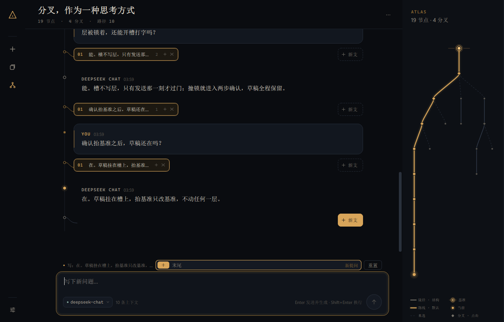
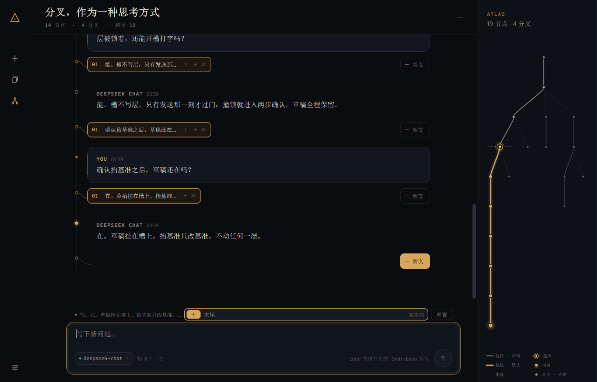

# Delta — 设计说明（一页）

## 三份互斥方案

1. **无限画布树**（QGraphicsView）。节点按树布局，拖拽、缩放、空间化分叉最直观。代价：读一段长链要在二维里移动，焦点、滚动、重启恢复都变复杂；它把「读」降级成「逛」。否决。
2. **三栏常规聊天**（侧栏 + 气泡 + 树状目录）。实现快、认知门槛低。代价：树只是右侧附录，分叉在正文里不可见；三栏挤压阅读宽度；整体像一个换皮聊天工具。实际做了 V1 后否决。
3. **单脊线 + 层入口 + ATLAS（采用）**。正文只画根 → 视图叶的一条链；每一层用一行标签作为入口；右侧 ATLAS 给出整棵树的形状。代价：ATLAS 在几百节点会变密，标签只能截一行；换来连续的阅读和可解释的局部重排。

## 状态与派生

**状态三样**：结构（节点 + parent；出生序只增不改；每层展示序）、每层至多一个活动孩子、基准。

**派生**：捷径链 = 根 → 基准；锁层 = 链经过的每一条边对应的层；视图叶 = 基准沿默认走到底；视图 = 根 → 叶的祖先链。基准以上走结构，基准以下走默认。

## 槽是意图，不是命令

层上有两类槽：末尾槽（这一层再来一个）和每颗备选自己的槽（以它为底稿）。一个槽最多一份草稿：模式 + 文本 + dirty。同一层可以有多份草稿；同一时刻只有一个活跃槽，输入框归它。草稿与活跃槽存 ui.slots 子文档（版本化），旧 ui.draft 按视图叶映射到对应槽。

模式决定三件事：打开时文本、重置回到哪、执行时发生什么。初始文本是纯函数，不存；未写过（clean）时文本跟随初始（底稿流式时会继续长），写过（dirty）则冻结。重置回到当前初始并清 dirty；模式切换 clean 无感、dirty 要确认，并可撤销一次。持久化只写 dirty 草稿：clean 草稿等于"不存在"，缺省读取就是当前模式的初始文本；活跃槽若指向 clean 槽则存 None，读回时回默认。

## 标签条与目标标记

标签条是层的入口。滚轮（含 Shift）在标签条上始终横向滚动，到两端也消费事件，不穿透正文。每颗标签有可见的 +（打开该备选的槽）和 ×（关闭）；打开时标签与输入框共用一套标记：同编号、同描边、标签下划线；末尾小签也有打开态。输入框上方是目标标记（写层 + 编号/底稿 + 模式），不是一行弱说明。单孩子层也显示紧凑标签行，不能只靠右键。

## ATLAS：一套三层语言

ATLAS 要同时回答三件事：这一层默认会走向谁、你现在被钉在哪、基准以上和以下分别是什么。

- **线型说默认**：同一层里至多一条实线（默认孩子），其余是虚线。虚线不是"不可用"，是"没被选"。
- **颜色说谁说了算**：灰线是结构——root → 基准的捷径链，每一步都是 parent 事实；金线是选择——基准 → 叶的路线，每一步都是默认。亮度顺带分层：虚线深灰 < 实线灰 < 捷径浅灰 < 路线金，越亮越靠近"我现在在读的"。
- **标记说角色**：双环加两侧短线是基准（被钉住的那个点）；单环加光晕是当前叶；菱形是分叉；实心点是普通节点。
- **点之前先知道**：悬停卡片写角色、这一支的状态（基准 / 当前 / 捷径链 / 路线 / 分叉 / 分支）、正文前 58 字，最后一行是"点击 → 把基准设到这里"。

否决过的：

- **给边加箭头**：树形已经把方向画出来了，箭头只是噪声；真正缺的信息是"默认 / 没选"，所以拿线型去说它。
- **节点上写文字标签**：258px 宽，二十个节点就会糊成一团；内容交给悬停卡片，图上只留形状。
- **把 ATLAS 做成可缩放画布**：这一轮要的是"这一眼能不能分辨"，不是"能不能导航"；缩放会带来平移、焦点、命中测试，都不付这个账。
- **用虚线表达捷径**：实线 / 虚线已经被"默认 / 未选"占用，同一根线不能有两种语法。
- **在图上加"设基准"按钮或拖拽**：ATLAS 唯一的写入口就是点节点（set_baseline），加控件就是加新的写层入口。

同一棵树：基准在根时整条视图都是路线（金）；基准抬到中间后，上面那段变成灰色捷径链，下面仍是金色路线，基准自己带双环和两侧短线。

## 发送是命令，不是塞消息

发送那一刻才从槽推导命令。基本命令声明：**写哪一层、读什么、效果、逆操作**。写作用域只有一层；读不受限。发送新提问 / 改问 = 提问层加提问 + 新提问层加回答，两步各自过门；再生成 / 按意见改 / 自己改 = 单步写回答层。按意见改为空等于普通再生成。提问槽里的「让模型改问法」是草稿动作，模型结果只替换文本，不落节点。

执行器对每一步先 require_open(write_layer)，再进入该层的写作用域调用层写入。层写入方法在作用域之外一律 ScopeError；命令层之外的代码直接调层写入会被测试挡住。唯一的全局例外是「把捷径写进默认」：显式确认，只写链上各层的默认，不解锁、不改基准。

锁只作用于会改层的命令；开槽、打字、草稿动作都不写层，所以锁层上仍可准备意图。发送撞锁时进入两步确认：第一步不改模型，第二步抬基准，草稿全程保留，抬完再按一次发送。

## 几个关键选择

- **回答备选两种模式**：按意见改（草稿是意见，模型直接产出新回答节点）和 自己改（草稿是回答原文，不调模型，追加新节点）。回答里装的是模型的话，模型可以直接生产；提问里装的是用户的话，模型只能提议。
- **读**：祖先链 + 被改的那一条本身，排除它的后代；默认不读兄弟。重写回答时额外读意见；空意见退化成普通再生成。
- **逆操作**：加孩子 → 关闭它；激活/重排 → 反向；关闭/空占位清理 → 无逆操作，显式不可撤销。模式切换的撤销是草稿级一步快照，不是树级 undo。
- **活跃槽粘住**：点开哪个就是哪个；视图切换不偷走它。写层不在视图里时目标标记变红、写层名加"不在视图"前缀，并给显式定位（set_baseline，不自动跳）；执行成功后活跃槽移到新视图叶的末尾槽。
- **单孩子层**：也显示一条 48px 的紧凑标签行（标签含 +、×、末尾小签）；右键菜单仍是快捷方式。连体标签形态留到下一轮。

## 砍掉

- 指针（当前位置）、首选圆点、从任意消息分叉的按钮、卡片上的删除/重试按钮。
- 路径副本；「重排就是清空重建」；标签条换行。
- Alt+←/→ 和 Alt+↑/↓：没有指针可走，兄弟切换只发生在看得见的层上。

## 迁移

- **对话 schema 1 → 2**：旧可见链（根 → 旧指针）一次性写进默认，基准 = 根；旧指针停在分支中间时清掉它自己的默认，让首屏停在用户最后看到的节点。链外旧首选保留。不降级。
- **ui 子文档**：旧 ui.draft 按视图叶映射到对应槽，不丢字；活跃槽有效则恢复；节点/层被删时相关槽与草稿删除；clean 草稿不写，缺省即初始。

## 热路径

- **切换**：只改一个默认；视图前缀控件对象不动，只换后缀；回访复用缓存卡片。
- **流式**：只改一个卡片；14ms 批量。
- **重启**：原子 JSON +（行 key, offset）滚动锚点 + 基准 + 活跃槽/草稿。
- **门禁**：锁在调用时现算，不缓存；写作用域每次基本命令开一次。

## 代价（不藏）

- 标签条切换会重建这一层的 chips；单孩子标签行可见后，BENCH 的层切换 p95 31.54ms（含 warm-up），仍在两帧以内，但比上一轮高。
- 单孩子层现在是紧凑标签行，不是连体标签；每层多一行，长对话滚动更长；连体形态下一轮补。
- 目标标记和槽按钮仍是文字/自绘小控件，视觉权重下一轮统一。
- ATLAS 没有搜索/缩放；几百节点会变密。
